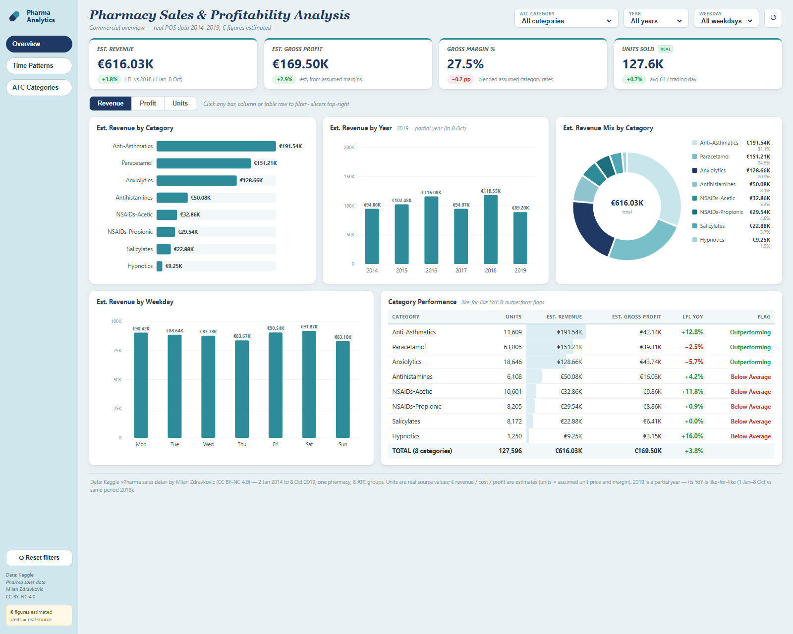

# Pharmaceutical Commercial Analytics — Excel · Power BI · HTML

A commercial analytics portfolio project built on **real pharmacy point-of-sale
data** (Kaggle, 2014–2019, 8 ATC drug groups). It answers three business
questions:

1. **Which drug categories sell best?** — volume vs value vs margin mix
2. **How does demand move over time?** — years, months, weekdays, trading hours
3. **Where does performance need attention?** — like-for-like growth, seasonality,
   outperform flags

▶ **[Live demo — interactive dashboard](https://khyaatirungta.github.io/pharmaceutical-commercial-analytics/dashboard/)**
(zero dependencies, runs entirely in the browser)



---

## What's inside

| Path | What it is |
|---|---|
| [`excel/Pharma_Sales_Analysis.xlsx`](excel/Pharma_Sales_Analysis.xlsx) | 6-sheet workbook: KPI dashboard, category analysis, time analysis (incl. weekday×hour heatmap), findings. **Every cell is a live formula** (SUMIFS/INDEX-MATCH) over the 16,848-row fact table — no hard-coded numbers. |
| [`powerbi/`](powerbi/) | Complete Power BI build kit: `measures.dax` (like-for-like YoY, flags, switchers), `data_model.md` (table/relationship recipe), `build_guide.md` (click-by-click for 3 pages matching the Excel/HTML design). |
| [`dashboard/`](dashboard/) | **Zero-dependency HTML dashboard** (vanilla JS + SVG, no CDN). Three pages — Overview, Time Patterns, ATC Categories — with slicers, metric toggle (Revenue/Profit/Units), cross-filtering, a trading-hour heatmap and reference-style KPI cards. Just open `dashboard/index.html` in a browser. |
| [`data/`](data/) | Raw Kaggle extracts (`kaggle_raw/`), the prepared fact table, the hour profile, and a full [data dictionary](data/Data_Dictionary.md). |
| [`scripts/`](scripts/) | Three reproducible Python scripts: `01_prepare_kaggle_data.py` → fact table, `02_build_excel.py` → workbook, `03_export_dashboard_data.py` → dashboard payload. |
| [`Findings_and_Recommendations.md`](Findings_and_Recommendations.md) | What the analysis found and what to do about it. |

## Headline numbers

| Metric | Value |
|---|---|
| Period | 2 Jan 2014 – 8 Oct 2019 (2,106 trading days) |
| Units sold *(real)* | **127,596** |
| Est. revenue *(units × assumed prices)* | **€616.0K** |
| Est. gross profit / margin | **€169.5K / 27.5%** |
| Like-for-like 2019 vs 2018 (1 Jan–8 Oct) | **+3.8% revenue**, +0.7% units |
| Largest category | Anti-Asthmatics — 31.1% of est. revenue |
| Volume leader | Paracetamol — 49.4% of units, only 24.5% of revenue |
| Seasonality | Jan strongest (index 1.23), Jul weakest (0.78) |
| Trading pattern | Saturday peak day (14.9%), busiest hour 19:00 |

> **Important:** units are real source data; € revenue/cost/profit are
> **estimates** derived from documented per-category price and margin
> assumptions (see [`data/Data_Dictionary.md`](data/Data_Dictionary.md)).
> 2019 is a partial year (ends 8 Oct), so its YoY is **like-for-like**
> (1 Jan–8 Oct vs the identical window of 2018).

## Data source & licence

Kaggle — [*Pharma sales data* by Milan Zdravković](https://www.kaggle.com/datasets/milanzdravkovic/pharma-sales-data)
(CC BY-NC 4.0): ~600,000 POS transactions from one pharmacy, pre-aggregated to
hourly/daily/weekly/monthly files for 8 ATC groups. All raw files are kept
verbatim in `data/kaggle_raw/`.

## Rebuild / refresh

```bash
python scripts/01_prepare_kaggle_data.py   # raw CSVs → fact table + hour profile
python scripts/02_build_excel.py           # fact table → Excel workbook
python scripts/03_export_dashboard_data.py # fact table → dashboard/data.js
```

Power BI: follow [`powerbi/build_guide.md`](powerbi/build_guide.md) in the
Power BI Desktop GUI (model ≈10 min, three pages ≈35 min). After replacing the
CSVs, use **Refresh** — all measures and visuals recompute; the HTML dashboard
picks up `data.js` on reload.

## Repository

Built for and pushed to
[`github.com/KhyaatiRungta/pharmaceutical-commercial-analytics`](https://github.com/KhyaatiRungta/pharmaceutical-commercial-analytics)
— the dashboard is also published via GitHub Pages at
`khyaatirungta.github.io/pharmaceutical-commercial-analytics/dashboard/`.
Tools: Python (pandas + openpyxl), Power BI Desktop (DAX), vanilla
HTML/CSS/JS.
